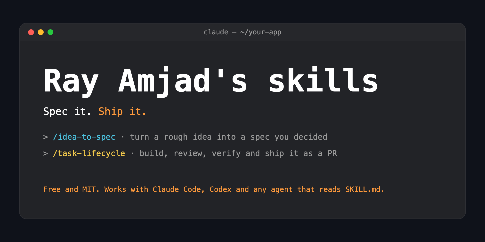

# Ray Amjad's skills

**Agent skills for shipping real changes with a coding agent: spec it, then ship it reviewed and verified.**

Works with Claude Code, Codex and any agent that reads `SKILL.md` files. Free and MIT licensed.

| Skill | What it does |
|---|---|
| [`/idea-to-spec`](./skills/idea-to-spec/SKILL.md) | Turns a rough idea into a short, evidence-backed spec: starting point, goals and non-goals, constraints, and proof. Every line is a decision you made or confirmed |
| [`/task-lifecycle`](./skills/task-lifecycle/SKILL.md) | Ships a change as a reviewed and verified PR: one builder, independent review and fix rounds, then a verify step that drives the real app. Asks you before it merges |


They chain: the spec's Proof section is the answer key, and `/task-lifecycle` builds and verifies against it.

## Install

<details open>
<summary><strong>Claude Code</strong></summary>

```text
/plugin marketplace add ray-amjad/skills
/plugin install ray-amjad-skills@ray-amjad
```

</details>

<details>
<summary><strong>Codex</strong></summary>

```bash
codex plugin marketplace add ray-amjad/skills
codex plugin add ray-amjad-skills@ray-amjad
```

</details>

<details>
<summary><strong>Any other agent, or files you can edit</strong></summary>

```bash
npx skills@latest add ray-amjad/skills
```

Or copy the folders you want from `skills/` into `~/.claude/skills/` (Claude Code) or `~/.agents/skills/` (Codex).

</details>

## idea-to-spec

You give it a rough idea. It does the homework first (reads the code, probes the facts, never asks you something it can look up), drafts a spec and has a fresh agent attack it, then interviews you one decision at a time. It plays the whole spec back before it writes anything, and publishes it as a GitHub issue or a file.

## task-lifecycle

The default path from "build this" to a merged change. One builder writes the change on its own branch and records every judgement call in implementation notes. Independent reviewers read the diff, a fixer resolves what they confirm (up to two rounds), and a verify step drives every changed flow against the real app and a real non-production database. It stops and asks before merging, then checks the live site after deploy. It also runs on a change that already exists: "put this branch through the loop".

It gets sharper without adding reviewers:

- **Cheap checks first.** The builder runs your CI's lint, type check and tests locally before the PR opens, so CI and review never pay to find a typo.
- **REVIEW.md, from the default branch.** Your repo tells the reviewers what to check and what to skip, at the root and per folder. The rules are always read from the merged copy, never from the PR, so a change can't rewrite the rules that judge it.
- **Each round builds on the last.** Round 2 gets a ledger of what round 1 found and how each item was settled, and reviews the fixes instead of starting over.
- **Misses become rules.** A bug that gets past review and is caught later becomes a proposed REVIEW.md rule; the second time the pattern shows up, it opens a PR for you.
- **Old code as the answer key.** A refactor or migration runs the base and the head on the same generated inputs and diffs them; invariant code gets property tests.
- **Every commit is stamped.** `Verified: checks, /code-review, codex` or `Verified: none`, so you can ask git which changes were never proven.


## License

MIT. See [LICENSE](./LICENSE).
