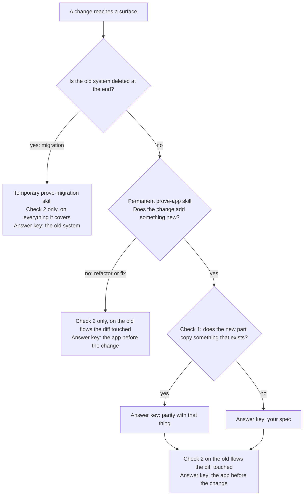

# Prove It

**Skills that make your coding agent prove its work.**

Your agent says "done". The tests pass. The code looks right. Then you open the app and the button does nothing.

Prove It gives your repo its own verification skill: one that launches your real app, drives it the way a user does, saves the evidence and cleans up after itself. Then it keeps that skill honest, and tries to fool it.

Works with Claude Code, Codex and any agent that reads `SKILL.md` files. Free and MIT licensed.

**Learn it in 7 days.** The free email course teaches one idea a day, using real repos and the mistakes agents actually make. You'll also hear about new skills when they land.

**[Get the free 7-day course](https://www.agenticcoding.school)** <!-- TODO: switch to the course page URL once it is live -->

## Install

<details open>
<summary><strong>Claude Code</strong></summary>

```text
/plugin marketplace add ray-amjad/skills
/plugin install ray-amjad-skills@ray-amjad
```

</details>

<details>
<summary><strong>Codex</strong></summary>

```bash
codex plugin marketplace add ray-amjad/skills
codex plugin add ray-amjad-skills@ray-amjad
```

</details>

<details>
<summary><strong>Any other agent, or files you can edit</strong></summary>

```bash
npx skills@latest add ray-amjad/skills
```

Or copy the folders you want from `skills/` into `~/.claude/skills/` (Claude Code) or `~/.agents/skills/` (Codex).

</details>

Then, in the repo you want to verify:

```text
/create-prove-it
```

## How a check works

A check has three parts. The **surface** is where a real user or program meets the change: a page, an API, a CLI, a database. The **answer key** says what right looks like, and the agent that made the change did not write it. The **comparison** asks whether what happened matches the answer key.

Answer keys form a ladder, best first:

1. **An old system** that already does the same job. Drive both and compare.
2. **A snapshot**: a saved copy of a result you know is good, like a screenshot or API responses from before the change.
3. **An independent test suite** that does not depend on the code it checks.
4. **A spec**: flows and acceptance criteria written before the code, specific enough to fail.
5. **Nothing**: the agent decides what right means. The weakest, so Prove It flags it.

Every change gets up to two checks. **Check 1** asks whether the new part works, and runs only when the change adds something. Its answer key is parity with the thing it copies, if it copies something that exists, or else your spec. **Check 2** asks whether the old stuff still works, and runs only on the old flows whose code the diff touched (shared code counts: schema, auth, nav, a shared component). Its answer key is the app before the change. A change made only of new files gets a quick smoke test. Prove It never checks the whole app.

Prove It never writes your spec either. It finds the one you already wrote, in the PR, the issue or the diff, or asks you for it.

## 2 kinds of prove skill

- **Permanent `/prove-<app>`**: lives in the repo for good and runs after every change. One section per surface (web, API, MCP, CLI). Adding a surface adds a section, not a skill.
- **Temporary `/prove-<migration>`**: for one big migration, such as Python to Rust. Runs the old and new systems side by side and compares. Its end step moves its cases into `/prove-<app>` as snapshots, then deletes it.

The rule: if the old thing is deleted at the end, it is a migration. If the old thing stays, it is the app.



| Change | Skill | Answer key |
|---|---|---|
| Add an MCP server | Permanent, adds an MCP section | Parity with the app (same action, same data) |
| Change the app and the MCP server together | Permanent | Your spec plus parity: both can be wrong the same way |
| A mic picker in the app | Permanent | Your spec, and the app before the change for the rest |
| Python API to Rust | Temporary | The old Python API, with shadow traffic |
| Next.js to React Router | Temporary | The old Next.js app |

## Why it exists

Coding agents fail in the same few ways. Each skill fixes one.

### 1. "Done" means the code compiles

**The problem.** The agent reads its own diff, runs the tests and calls it done. Tests mock the parts that break. Nobody opened the app.

**The fix.** [`/create-prove-it`](./skills/create-prove-it/SKILL.md) gives your repo a `prove-<app>` skill that runs the real app, so any agent can type `/prove-<app>` at the end of a change, before it says done. It reads the diff, works out which pages, routes and commands the change reaches, drives those and tries to break them. Or name a flow ("prove checkout") and it proves that. It starts by asking where users actually meet your app (the web page, API, CLI, database, emails, background jobs) and whether your agent can reach each of those from your machine. Where it can't, it suggests a way in: a sandbox, a local emulator, a seeded test account or a headless browser. For each main flow it finds an answer key and its rung, and flags the flows that have none. Then it shows you a brainstorm:

| Method | Answer key | Catches | Misses | Cost | Reachable now? |
|---|---|---|---|---|---|
| Browser, driven like a user | 4: spec | The open count not updating after a tick | Whether the task was really saved | Chromium once, ~5s a run | Yes |
| API calls | 2: saved responses from main | Empty titles accepted, wrong status codes | What the page does with the response | Free, under 1s | Yes |
| Stored-state check | 4: spec | "Saved" on screen, nothing on disk | Whether a user can see it | Free | Yes |
| Email capture | 5: nothing | Reminders that never send | Real delivery | A local mail catcher | No: needs `MAIL_API_KEY` |

You pick the methods. It writes the skill using your repo's real commands and selectors, then runs it once, end to end, and shows you the receipt. The proof runs in a fresh sub-agent that sees the flows and answer keys but not the builder's reasoning. A BROKEN verdict goes back to the builder to fix, then the check runs again, up to 3 rounds.

Adding a surface? Tell it "I'm adding an MCP server". It adds an MCP section to your existing `prove-<app>`, with parity against the app as its answer key (the same action through both should leave the same data). Migrating? Tell it "verify this migration" and it writes a temporary skill instead.

### 2. The verifier goes stale

**The problem.** You rename a button, add a page, change a port. The verification skill still describes last month's app, and the next agent trusts it.

**The fix.** [`/maintain-prove-it`](./skills/maintain-prove-it/SKILL.md) reads the receipts from past prove runs: the steps that failed, the retries, the command that finally worked, the step that broke on a change that had nothing to do with it. Tell it about any bug that slipped past and it adds the check that would have caught it. When the app and the skill disagree, it works out which one is wrong. It fixes the skill, proves every fix live, and reports bugs in the app without touching your code. It never rewrites an answer key to match the app: that disagreement goes to you.

### 3. The verifier says PROVED on a broken app

**The problem.** A check that can't fail is worse than no check, because it gives you confidence you haven't earned.

**The fix.** [`/audit-prove-it`](./skills/audit-prove-it/SKILL.md) breaks your change on purpose, in the files it touched, one small realistic bug at a time: a counter off by one, a save that never happens, the right output with the wrong exit code. A fresh agent then runs your verifier, with its answer keys, without knowing what was planted. You get a scorecard, every miss with the fix for it (to the check and to the answer key), and an untouched working tree at the end.

In testing, the first audit of a generated verifier planted 7 bugs. The agents doing the checking caught 5, but the verifier's own scripts caught only 1, because every check ran against a single record. That finding now shapes how `/create-prove-it` writes checks.

## The skills

| Skill | What it does | When |
|---|---|---|
| [`/create-prove-it`](./skills/create-prove-it/SKILL.md) | Asks "the app, or a migration?", finds your surfaces and answer keys, brainstorms how to verify them, then generates (or adds a surface section to) `prove-<app>`, or a temporary `prove-<migration>`, and proves it works | Once per repo, again per new surface or migration, then `/prove-<app>` at the end of every change |
| [`/maintain-prove-it`](./skills/maintain-prove-it/SKILL.md) | Learns from past prove runs and missed bugs, fixes the skill where it drifted, proposes answer keys where flows have none, and suggests a migration skill's end step once the old system is going | After prove has run a few times, or a bug slipped past |
| [`/audit-prove-it`](./skills/audit-prove-it/SKILL.md) | Plants bugs in a change (in the new system only, for a migration), checks whether the verifier catches them, and adds misses to the answer keys with your OK | After creating it, then now and then |

## What it adds to your repo

```text
your-repo/
  .claude/skills/prove-<app>/      # .agents/skills/ on Codex
    SKILL.md                       # scope, sort the change, find the spec, one section per surface, evidence, clean up
    scripts/                       # start, health, stop, scripted checks
  .claude/skills/prove-<migration>/  # temporary, deleted at its end step
    SKILL.md                       # old and new side by side, cases, compare, end step
    scripts/                       # start both, compare one case
  .prove-it/
    snapshots/                     # answer keys: known good results (committed)
    runs/<timestamp>-<slug>/       # receipts (what was proved, verdicts, retries), screenshots, logs (git-ignored)
    audits/<timestamp>/report.md   # git-ignored
```

## License

MIT. See [LICENSE](./LICENSE).
